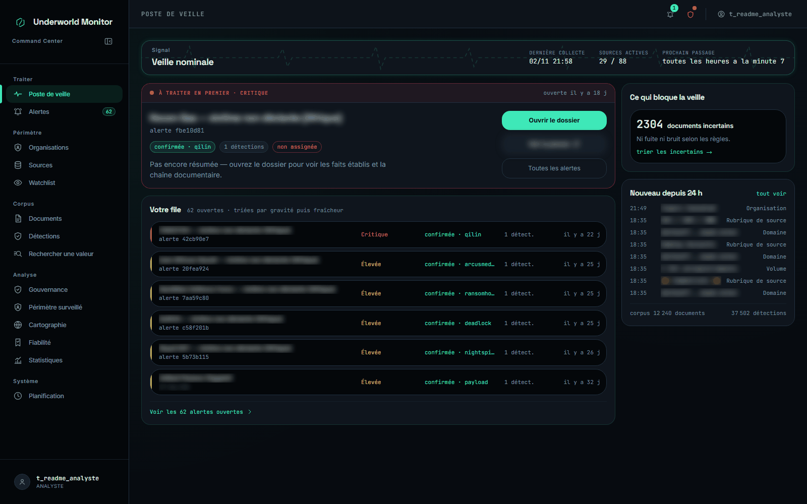
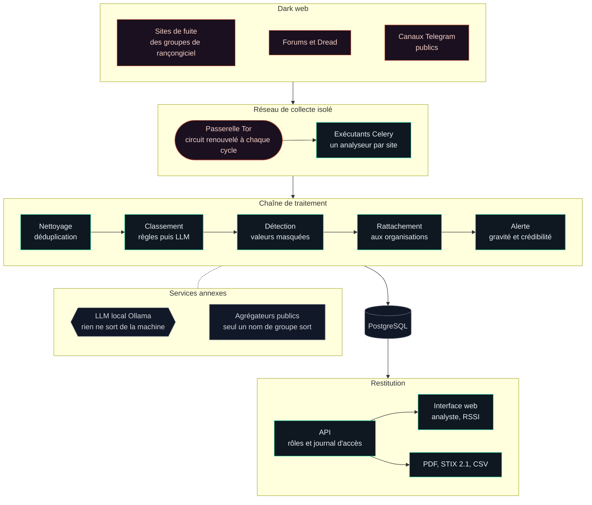
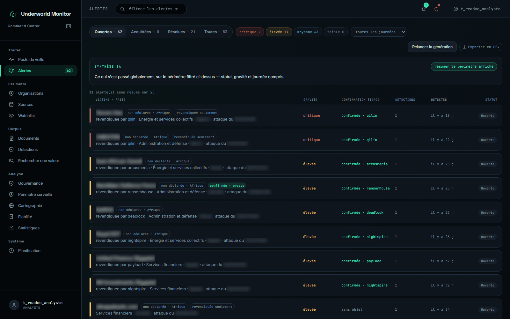
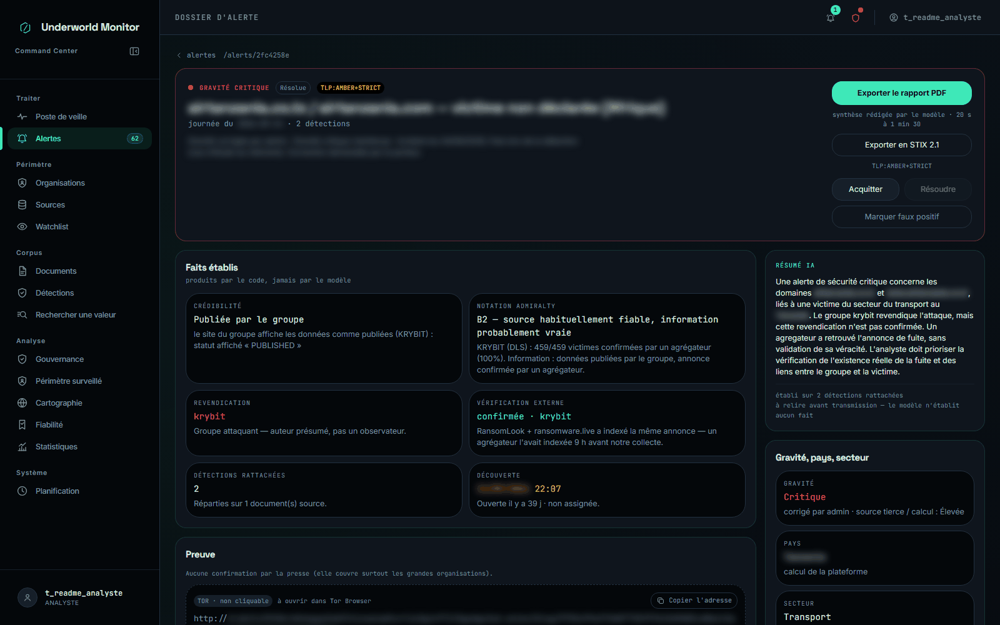
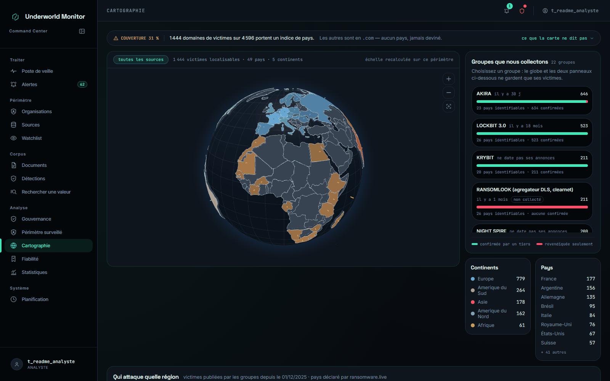
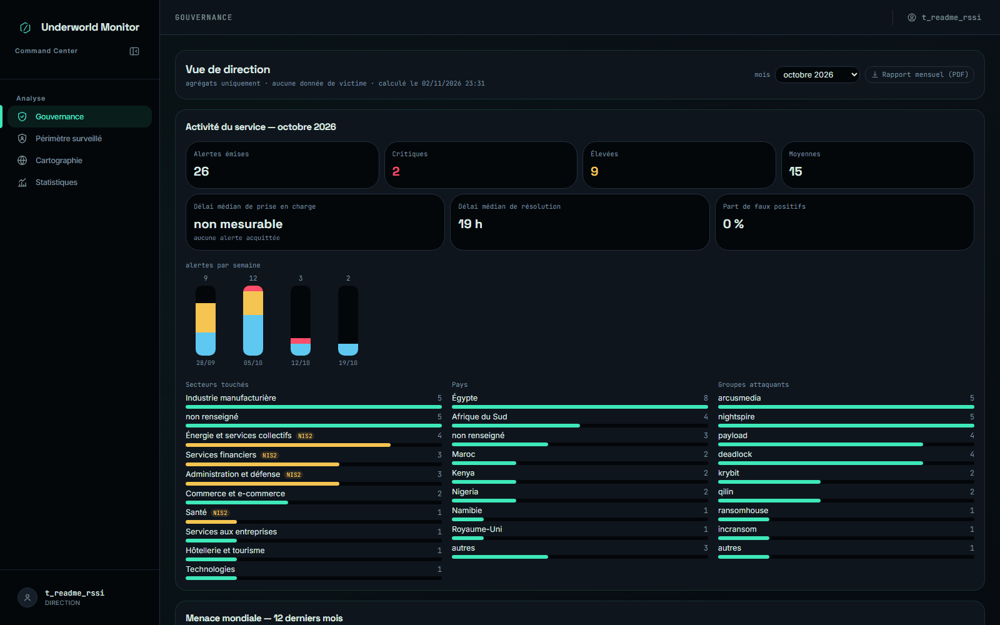

<div align="center">

# Underworld Monitor

**Savoir que son organisation a été nommée victime, avant de l'apprendre par la presse.**

Plateforme auto-hébergée de veille sur les fuites de données publiées sur le dark web.




</div>

---

## Le problème

Quand un groupe de rançongiciel compromet une organisation, il publie son nom
sur son site de fuite pour faire pression. L'information est là, exposée par
l'attaquant lui-même. Pourtant, la victime l'apprend souvent des jours plus
tard, par un journaliste ou un partenaire. Les services commerciaux qui
surveillent ces sites existent, mais leur coût les met hors de portée de
beaucoup d'organisations.

**Underworld Monitor** lit ces sites à la source, repère les organisations que
vous surveillez, et produit pour chacune une alerte **vérifiable** : qui
revendique, quand, avec quelles preuves, et à quel point c'est grave.

## Comment ça marche



- **La collecte ne sort que par Tor**, depuis un réseau Docker séparé : la
  passerelle Tor et la base de données ne partagent aucun réseau.
- **Rien n'est rapatrié** : la plateforme lit les annonces, jamais les
  données fuitées. Les valeurs détectées (adresses, identifiants) sont
  masquées et hachées avant d'être écrites.
- **Le modèle de langue tourne en local.** Il tranche les annonces que les
  règles laissent incertaines et rédige les résumés, sans qu'aucun extrait ne
  quitte la machine.
- **Chaque alerte se vérifie** : document d'origine, revendication du groupe,
  confirmation par un agrégateur ou par la presse.

## Aperçu

<table>
  <tr>
    <td width="50%"><br><sub><b>File des alertes</b> : triée par gravité, avec le groupe, le secteur et la confirmation tierce.</sub></td>
    <td width="50%"><br><sub><b>Dossier d'alerte</b> : faits établis par le code, notation Admiralty, résumé du modèle, preuves.</sub></td>
  </tr>
  <tr>
    <td width="50%"><br><sub><b>Cartographie</b> : victimes par pays et groupes actifs, sur un globe interactif.</sub></td>
    <td width="50%"><br><sub><b>Vue de direction</b> : agrégats mensuels pour un RSSI, sans aucun nom de victime.</sub></td>
  </tr>
</table>

<sub>Les noms de victimes, pays et dates d'incident sont floutés sur ces captures.</sub>

## Fonctionnalités

| | |
|---|---|
| **Collecte** | Analyseurs dédiés aux sites de fuite (une victime par document), forums, Dread, canaux Telegram. Rotation de circuit et de User-Agent, délais de politesse, détection des changements d'adresse. |
| **Classement** | Règles reproductibles (fuite, bruit, incertain), puis arbitrage des cas incertains par un modèle de langue local. |
| **Détection** | Domaines, adresses, identifiants, cartes (Luhn) et IBAN (mod-97), noms d'organisations. Masquage et hachage dès l'écriture. |
| **Alertes** | Rattachement par domaine ou par nom aux organisations surveillées, groupes et filiales, alertes régionales pour les victimes non déclarées. |
| **Qualification** | Gravité fondée sur les secteurs critiques NIS2 et la fraîcheur de l'incident. Crédibilité sur un axe distinct : presse, statut de publication, corroboration. Notation Admiralty, marquage TLP. |
| **Restitution** | Dossier d'alerte avec ses preuves, rapport PDF, export STIX 2.1 et CSV, synthèse par le modèle de langue, vue de direction. |
| **Exploitation** | Planification éditable depuis l'interface, test de disponibilité des sources, trois rôles, sessions révocables, journal des accès aux alertes. |

## Ce qu'elle ne fera jamais

- Télécharger, exploiter ou rediffuser des données fuitées.
- Tester des identifiants trouvés, ou contourner une protection anti-robot.
- Désanonymiser une personne ou contacter une victime.
- Stocker une valeur sensible en clair.
- Interroger une source autrement que par Tor.

Ces règles s'imposent à toute contribution. Elles sont détaillées dans
[`CONTRIBUTING.md`](CONTRIBUTING.md).

## Démarrage rapide

Prérequis : Docker et Docker Compose, Node.js 24, et
[Ollama](https://ollama.com) pour les fonctions de modèle de langue.

```bash
# 1. Configuration : renseigner au minimum JWT_SECRET_KEY, PASSWORD_HASH_PEPPER,
#    POSTGRES_PASSWORD (et DATABASE_URL) et TOR_CONTROL_PASSWORD
cp .env.example .env

# 2. Services : API, base, Redis, Tor, exécutants, ordonnanceur
docker compose up -d --build

# 3. Schéma de la base, puis premier compte administrateur
docker compose exec backend alembic upgrade head
docker compose exec backend python -m app.scripts.create_user admin --role admin

# 4. Interface web, sur http://localhost:5173
cd frontend && npm ci && npm run dev
```

L'API répond sur `http://localhost:8000` (documentation interactive sur
`/docs`). Chaque variable, les composants facultatifs (modèle de langue,
Telegram, traduction) et le déploiement durable sont décrits dans
[`CONFIGURATION.md`](CONFIGURATION.md).

## Stack

| Couche | Technologies |
|---|---|
| API et logique | Python 3.12, FastAPI, Pydantic v2, SQLAlchemy 2.1, Alembic |
| Tâches | Celery, Redis, ordonnanceur lu en base |
| Collecte | Tor, Patchright (Playwright), BeautifulSoup, Telethon |
| Analyse | spaCy, ctranslate2, Ollama (Qwen3 8B), langchain |
| Données | PostgreSQL 16 |
| Interface | React 18, TypeScript, Vite, Tailwind, Three.js |
| Livrables | fpdf2 (PDF), STIX 2.1 |

## Développement

```bash
docker compose exec backend pytest                         # plus de 1 600 tests
docker compose exec backend sh -c "ruff check . && black --check ."
docker compose exec backend mypy                           # types du cœur
cd frontend && npx tsc --noEmit && npm run lint && npm run build
```

Les tests d'intégration tournent dans une transaction annulée : ils ne
laissent aucune trace en base. L'intégration continue les rejoue sur un
PostgreSQL vierge, sans jamais toucher à Tor ni à une source.

## Avertissement

Underworld Monitor est un outil de veille **défensive**. Il aide une
organisation, ou l'équipe chargée de la protéger, à apprendre qu'elle a été
nommée comme victime. Il ne doit pas servir à récupérer, exploiter ou diffuser
des données fuitées. Chaque utilisateur est responsable du respect du cadre
légal applicable dans son pays.
